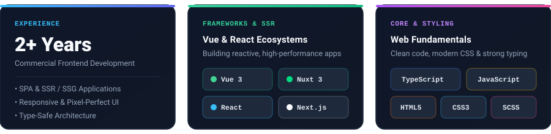

  <!-- Hero Banner -->
  

   

  <!-- Animated Typing Subtitle -->
  

   

  <!-- Contact & Quick Links -->
  

    
    &nbsp;
    
    &nbsp;
    
  

---

### 👨‍💻 About Me

I'm **Ivan Zhuravlev**, a **Frontend Developer** with **2+ years of experience** crafting responsive, high-performance, and maintainable web applications. I specialize in both the **Vue (Vue 3, Nuxt)** and **React (React, Next.js)** ecosystems, with a strong emphasis on **TypeScript**, clean component architecture, and polished user interfaces.

- 🚀 **2+ years** of hands-on experience building modern SPAs, SSR, and SSG web applications
- 🧩 Deep focus on **Vue 3 / Nuxt** and **React / Next.js** with strict **TypeScript** typing
- 🎨 Passionate about pixel-perfect layouts, modern **CSS3 / SCSS**, and smooth micro-interactions
- 💬 Always open to interesting projects, collaboration, and frontend discussions — reach me on Telegram: **[@Zhurravlev](https://t.me/Zhurravlev)**

---

### ⚡ Overview & Tech Cards

  

---

### 🛠 Tech Stack & Tools

  <!-- Skill Icons Showcase -->
  

    
  

  <!-- Categorized Badges -->
  <table>
    <thead>
      <tr>
        <th align="center">Category</th>
        <th align="center">Technologies</th>
      </tr>
    </thead>
    <tbody>
      <tr>
        <td align="center"><b>Languages</b></td>
        <td align="center">
          
          
        </td>
      </tr>
      <tr>
        <td align="center"><b>Frameworks & SSR</b></td>
        <td align="center">
          
          
          
          
        </td>
      </tr>
      <tr>
        <td align="center"><b>Markup & Styling</b></td>
        <td align="center">
          
          
          
        </td>
      </tr>
    </tbody>
  </table>

---

### 📊 GitHub Analytics & Activity

  
  

  

---

  <h3>🤝 Let's Connect</h3>
  
Have an exciting frontend project or job opportunity? Drop me a message!

  

